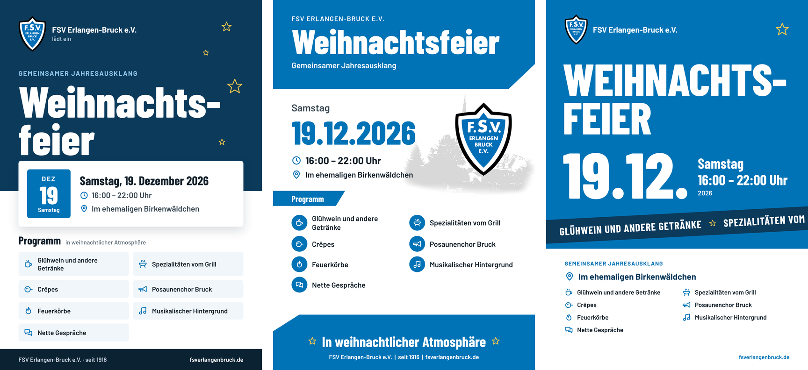

# FSV Erlangen-Bruck – Flyer und Plakate

KI-Skill und Vorlage für Veranstaltungsflyer des FSV Erlangen-Bruck e.V. im Vereinsdesign: A4-Plakat und A5-Flyer als PDF, dazu ein Quadrat (1080 × 1080) für Instagram, Facebook und WhatsApp.

Man nennt nur die Eckdaten, der Rest kommt aus einer festen Vorlage – Wappen, Farben und Schriften stimmen immer, und die KI erfindet nichts dazu.



| Stil | Aussehen |
|---|---|
| `website` (Standard) | wie die Vereinswebsite: Navy-Kopf, Terminkarte mit Kalenderblatt, Programm-Kacheln |
| `vereinszeitung` | wie die Vereinszeitung: blaue Schrägbänder, Wappen vor der Brucker Kirche |
| `typo` | Plakat ganz in Blau, Titel und Datum riesig, Laufband mit den Highlights |

## Installation

Welcher Weg passt, hängt davon ab, **wo** man mit der KI arbeitet:

| Ich arbeite mit … | Weg |
|---|---|
| Claude im Browser (claude.ai) oder im Chat der Claude-Desktop-App | [ZIP hochladen](#claude-chat-browser-und-desktop-app) |
| Claude Code, OpenAI Codex, Gemini CLI, Cursor, GitHub Copilot (Programmier-Werkzeuge) | [Kommandozeile](#programmier-werkzeuge-kommandozeile) |
| ChatGPT im Browser oder einer anderen KI ohne Skills | [SKILL.md als Anleitung](#ki-ohne-skill-unterstützung) |

> **Wichtig:** Die Kommandozeile installiert den Skill nur für die Programmier-Werkzeuge. Der normale Claude-Chat (Browser und Desktop-App) sieht diese Installation nicht – dort immer das ZIP hochladen.

### Claude-Chat (Browser und Desktop-App)

1. [`fsv-erlangen-bruck-flyer-plakat.zip`](https://github.com/sebastian-gehr/fsv-erlangen-bruck-flyer-plakat/releases/latest/download/fsv-erlangen-bruck-flyer-plakat.zip) herunterladen (aktuelle Fassung).
2. In Claude unter **Einstellungen → Fähigkeiten → Skills** die ZIP-Datei hochladen und den Skill einschalten. „Code-Ausführung“ muss eingeschaltet sein.
3. Einen neuen Chat beginnen.

### Programmier-Werkzeuge (Kommandozeile)

Voraussetzung: [Node.js](https://nodejs.org) ab Version 20. Der Befehl nutzt das Werkzeug [`skills`](https://github.com/vercel-labs/skills) und installiert den Skill für alle Projekte. Je Werkzeug einen Befehl kopieren und einzeln ausführen:

**Claude Code**

```bash
npx skills add sebastian-gehr/fsv-erlangen-bruck-flyer-plakat -g -a claude-code -y
```

**OpenAI Codex (GPT)**

```bash
npx skills add sebastian-gehr/fsv-erlangen-bruck-flyer-plakat -g -a codex -y
```

**Gemini CLI**

```bash
npx skills add sebastian-gehr/fsv-erlangen-bruck-flyer-plakat -g -a gemini-cli -y
```

**Cursor**

```bash
npx skills add sebastian-gehr/fsv-erlangen-bruck-flyer-plakat -g -a cursor -y
```

**GitHub Copilot**

```bash
npx skills add sebastian-gehr/fsv-erlangen-bruck-flyer-plakat -g -a github-copilot -y
```

Nach der Installation das Werkzeug **neu starten** (bzw. eine neue Sitzung beginnen), denn Skills werden nur beim Start geladen. In Claude Code lässt sich der Skill auch direkt mit `/fsv-erlangen-bruck-flyer-plakat` aufrufen.

Neue Fassung holen:

```bash
npx skills update
```

Entfernen:

```bash
npx skills remove fsv-erlangen-bruck-flyer-plakat
```

### KI ohne Skill-Unterstützung

Zum Beispiel ChatGPT im Browser: Den Inhalt von [`SKILL.md`](SKILL.md) als Anleitung in den Chat geben und die Eckdaten nennen. Die KI schreibt daraus die Daten-Datei (JSON); gerendert wird dann lokal wie unter [Ohne KI](#ohne-ki).

## Verwendung

Nach der Installation reicht ein Satz, zum Beispiel:

> Flyer für die Weihnachtsfeier, Sa 19.12.2026, 16–22 Uhr, ehemaliges Birkenwäldchen, Glühwein, Grill, Crêpes, Posaunenchor Bruck

> Plakat für die Tennis-Vereinsmeisterschaften 10.–11.07.2027 ab 10 Uhr, Tennisanlage, im Stil Vereinszeitung

Ergebnis: A4- und A5-PDF zum Drucken, PNGs zur Vorschau und das Quadrat für Social Media – als Entwurf zur Freigabe.

## Ohne KI

Voraussetzung: [Node.js](https://nodejs.org) ab Version 20. Einmalig im Ordner des Skills:

```bash
npm install
npx playwright install chromium
```

Dann die Beispiel-Datei `beispiele/weihnachtsfeier-2026.json` kopieren, Texte ändern und rendern:

```bash
node scripts/render.mjs meine-feier.json ausgabe                      # Stil website, alle Formate
node scripts/render.mjs meine-feier.json ausgabe --stil=vereinszeitung
node scripts/render.mjs meine-feier.json ausgabe --stil=typo --formate=a4,quadrat
```

Die Felder der Daten-Datei stehen in `SKILL.md` unter „Daten-Schema“. Die Schriften (Barlow) lädt die Vorlage von Google Fonts, dafür braucht der Rechner Internet.

## Inhalt

| Datei | Zweck |
|---|---|
| `SKILL.md` | Anleitung für die KI: Ablauf, Stile, Gestaltungsregeln, Daten-Schema |
| `vorlage/flyer.html` | feste Vorlage mit allen drei Stilen |
| `assets/` | Wappen (SVG) und Brucker Kirche |
| `scripts/render.mjs` | erzeugt PDF und PNG aus einer Daten-Datei |
| `beispiele/` | Beispiel-Daten |

## Regeln

Wappen, Farben und Schriften nicht ändern. Das Wappen ist Eigentum des FSV Erlangen-Bruck e.V. und nur für Vereinszwecke gedacht.
